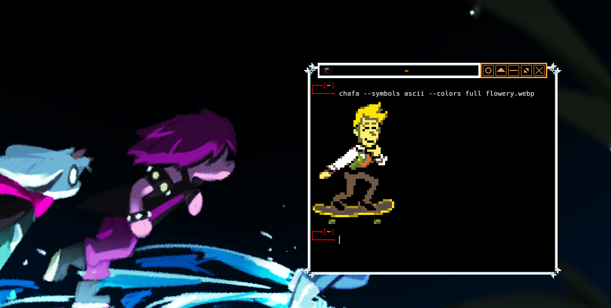

# DeltaXfmw4
Xfmw4 Window Borders based on the Deltarune Menus/Dialogue Box/Settings 
Note: 
1) this does not include a GTK theme, just the borders and buttons
2) if youre trying to port this to another window manager you might have problems with transparency. as far as I know only xfce and hyperland allow for this, havent tried with other window managers
3) does not include xhdpi displays, you might need to upscale the images otherwise it'll look small

# Preview

# Tips

best for dark backgrounds

# Third-party resources

the borders were taken from [Sprite Resources](https://www.spriters-resource.com/pc_computer/deltarune/asset/110943/)  
everything else is hand made by me
